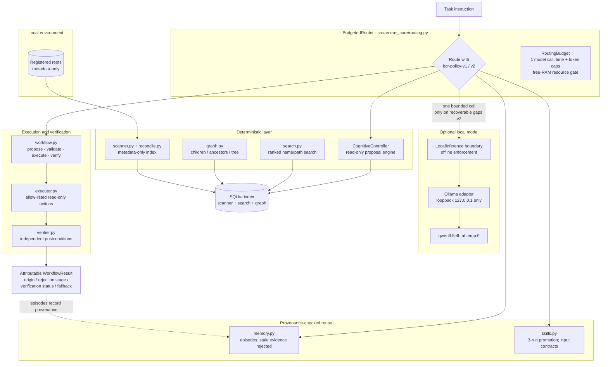

# ARCEUS

> **A local-first cognitive agent research framework that only believes what it can verify —
> and says so when it can't.**

ARCEUS investigates how far a small local language model and a deterministic, evidence-grounded
agent stack can go when every capability is bounded by explicit budgets, permissions, and an
independent verifier. It is a research framework for studying **verified task success per unit
of compute**, not a product, and it reports its negative results.


**Local-first, bounded, verified.** Indexing, search, routing, memory, and inference all run on
one machine. File contents never leave their location, model calls require a free-RAM safety
gate, and no action is called successful until a deterministic verifier says so.

---

## Why ARCEUS?

Autonomous agent workflows tend to be expensive, hard to verify, and good at producing
unsupported claims. ARCEUS rebuilds the agent loop around three questions:

1. **What did the evidence actually show?** — retrieval is source-grounded metadata over an
   explicitly registered index, and every task must cite its evidence.
2. **What may this step do?** — execution is proposal → re-validation → at most one
   allow-listed read-only action → independent verification. Model output never grants
   authorization and can never widen scope.
3. **What did it cost, and was it worth it?** — the BCR router chooses between deterministic
   planning, provenance-checked memory, verified-skill reuse, one bounded local-model call,
   clarification, and safe abstention — and abstention is a *correct* answer when the evidence
   cannot support correctness.

The frozen evaluations to date find that the honest abstention usually *wins*: a memory+skills
stack with **zero** model calls has outscored the model-using router on both measured suites.

---

## Design principles

| Principle | Where it lives |
|---|---|
| Deterministic-first | Router ordering: tool proposal → clarification → verified skill → fresh memory → gated model → safe abstention |
| Local-first inference | Loopback-only Ollama adapter; no cloud, no implicit downloads; offline capability enforced in code |
| Bounded resources | Per-task `RoutingBudget` (1 model call, time/token caps) and a ≥2 GiB free-RAM live-inference gate |
| Permission-bounded execution | Proposals re-validated against a typed contract; paths must resolve inside registered roots |
| Independent verification | `verifier.py` checks postconditions deterministically; no executed-but-unverified "success" |
| Provenance-aware memory & skills | Episodes carry source provenance; stale evidence is rejected; skills promote only after 3 distinct verified runs |
| Fail-closed abstention | Unknown/missing abstention reasons coerce to terminal; refused skills are never escalated around |
| Reproducible evaluation | Frozen, pre-registered suites with pinned digests; ground truth written independently of all system output |

---

## Architecture



Everything above the model box runs with **no** model installed. Importing ARCEUS never
starts a model process or opens a network connection. When a live model is unavailable or the
resource gate trips, tasks resolve as safely attributed abstentions — never as implied model
successes.

---

## Capability matrix

| Capability | Status | Evidence |
|---|---|---|
| Metadata-only index, reconciliation, roots | Stable | Phase 1 suite; benchmark artifacts |
| Ranked name/path search (no FTS) | Stable | Phase 1 |
| Structural graph queries | Stable | `graph-retrieval-v2` (525 tasks) |
| Offline inference boundary + Ollama adapter | Tested on Windows | `qwen3.5:4b` smoke via `LocalInference` |
| Read-only cognitive controller | Stable | `controller-action-v0` 12/12 deterministic |
| Bounded execute → verify workflow | Stable | `executor-workflow-v0` 12/12 deterministic, 10/12 model arm |
| Episodic memory (provenance, staleness) | Stable | `memory-lifecycle-v1` 9/9, 7/7 stale rejections |
| Verified-skill registry | Stable | `skills-servable-v1` 11/12 vs 5/12 baseline |
| Budgeted routing `bcr-policy-v1` | Frozen (negative) | `bcr-routing-v1`: 10/14 vs 14/14 no-model |
| Recoverable-abstention routing `bcr-policy-v2` | Policy-tested; live arm blocked | `bcr-routing-v2`: 14/16 both splits, 0 terminal escalations |
| Live-model end-to-end for `bcr-routing-v2` | **Not run** (free RAM < 2 GiB both attempts) | — |
| Content-aware retrieval / embeddings | Not implemented | out of scope so far |
| Linux / macOS execution | Not verified | Windows is the verified platform |

Every claim above links to a frozen suite in `evals/` and a report or JSON artifact in `reports/`.

---

## Quick start

Requires Python **3.11+** (verified on 3.13/3.14 on Windows). Runtime dependencies are std-lib
only; `pip` installs just the test/lint tooling.

### Windows PowerShell

```powershell
git clone https://github.com/akaKRISH/arceus-core.git
cd arceus-core
py -3.11 -m venv .venv          # or any 3.11+ interpreter, e.g. py -3.13
.\.venv\Scripts\Activate.ps1
python -m pip install -e ".[dev]"
python -m pytest                # full deterministic suite, no model needed
python -m ruff check src tests evals experiments scripts
python -m ruff format --check src tests evals experiments scripts
```

If PowerShell blocks script activation for that terminal only:

```powershell
Set-ExecutionPolicy -Scope Process -ExecutionPolicy Bypass
```

### Linux / macOS

```bash
git clone https://github.com/akaKRISH/arceus-core.git
cd arceus-core
python3 -m venv .venv
source .venv/bin/activate
python -m pip install -e ".[dev]"
python -m pytest
```

> Linux/macOS are not yet verified on real hardware — see
> [Limitations](#research-findings-and-limitations).

### Try the CLI deterministically

```powershell
arceus roots add "$PWD\demo-workspace" --label demo   # explicit, never a drive scan
arceus scan
arceus search "report" --limit 5
arceus graph tree "$PWD\demo-workspace" --depth 2
arceus status
```

All commands support `--help`, `--json`, and `--db PATH`. Exit codes: 0 success, 1 operational,
2 usage.

### Run the frozen benchmarks

```powershell
python -m evals.run_benchmark                       # graph-retrieval-v2 (deterministic)
python scripts/run_controller_benchmark.py          # controller-action-v0, deterministic arm
python scripts/run_executor_benchmark.py            # executor-workflow-v0, deterministic arm
python scripts/run_bcr_v2_benchmark.py --no-model   # all four bcr-routing-v2 policy arms
```

None of these touch your files: each builds its own temporary synthetic fixture and database.

---

## Optional local LLM setup

All deterministic phases above need **no model**. To reproduce the optional model arms:

1. Install [Ollama](https://ollama.com) and `ollama pull qwen3.5:4b` yourself
   (~3.4 GB — ARCEUS never downloads weights).
2. Ensure the model is reachable at `127.0.0.1:11434` (loopback only).
3. Check RAM: the live gate refuses inference unless **≥2 GiB (2048 MB)** of physical memory is
   free; a single `qwen3.5:4b` call at `num_ctx=2048` / `num_predict=256`, temperature 0, takes
   ≈2 s. Sequential only — one call per task, per the `RoutingBudget`.

```powershell
python scripts/run_bcr_v2_benchmark.py              # live arms; prints the gate verdict
python scripts/run_controller_benchmark.py --model
python scripts/run_executor_benchmark.py --use-model
```

Known behavior: the 4B model loses to the deterministic planner on the frozen planner suites
(1/12 vs 2/12 on `model-reasoning-v0`; the model path produced usable proposals for only 1/12
controller tasks without fallback). Treat model arms as research instruments, not features.

---

## Testing and reproducibility

| Layer | Command | What it proves |
|---|---|---|
| Unit + integration | `python -m pytest` | 428 passed, 2 skipped (Windows symlink-creation only); no model load |
| Lint | `python -m ruff check src tests evals experiments scripts` | clean |
| Format | `python -m ruff format --check src tests evals experiments scripts` | clean |
| Frozen deterministic benchmarks | `python -m evals.run_benchmark`, `scripts/run_*.py` | pinned suites, pinned seeds/fixtures |
| Pre-registered suites | `reports/bcr-routing-v2_preregistration.md` | frozen before measurement, digest-pinned |

Unit tests use mocked inference only. Frozen benchmark suites have versioned task definitions
with ground truth written independently of system output. Live-model experiments are separate,
documented, and gated.

Key reading:

- [SPRINT_STATUS.md](SPRINT_STATUS.md) — current phase tracker (source of truth for status)
- [reports/arceus_phase7_budgeted_cognitive_routing.md](reports/arceus_phase7_budgeted_cognitive_routing.md)
- [reports/arceus_phase7_1_recoverable_abstention.md](reports/arceus_phase7_1_recoverable_abstention.md)
- [reports/graph_retrieval_evaluation_v2.md](reports/graph_retrieval_evaluation_v2.md)
- [ARCHITECTURE.md](ARCHITECTURE.md) · [EXPERIMENT_PROTOCOL.md](EXPERIMENT_PROTOCOL.md) · [DECISIONS.md](DECISIONS.md)

---

## Research findings and limitations

Findings are stated exactly as the frozen artifacts support them. Numbers are from
fixed synthetic suites on one Windows machine; they are not population claims.

### What the frozen evaluations measured

| Suite | Result | Verdict |
|---|---|---|
| `bcr-routing-v1` (6 arms, 14+14 tasks) | no-model memory+skills **14/14** both splits; BCR 10/14 (4 calls); model-first 9/14 (5 calls); skills 14/14; deterministic-only 13/14 | **Reject** model escalation on any abstention: every model call replaced a correct abstention |
| `bcr-routing-v2` (4 arms, 16+16 tasks) | v2 policy permits 3 escalations/split vs v1's 7/split, **0 terminal**; policy stack 14/16 both splits = no-model baseline | Typed gate removes terminal escalation; **live-model end-to-end untested** (gate blocked: 816 MB free < 2 GiB) |
| `executor-workflow-v0` (12 tasks) | deterministic 12/12; real-model 10/12, both wrong proposals caught by the independent verifier | Verifier catches model errors; 0 fallback inflation |
| `memory-lifecycle-v1` | 9/9, 7/7 stale detections, 0 stale adoptions | Provenance staleness works; positive adoption still unexercised end-to-end |
| `skills-servable-v1` | skills/memory+skills 11/12 vs baseline 5/12; 0 incorrect adoptions | Verified-skill reuse is the one measured capability gain over deterministic-only |
| `graph-retrieval-v2` (525 tasks) | graph 525/525 ≡ path-derived control 525/525 vs name/path search 338/525 (64.4%) | Structural access is real; **no unique information advantage** over string reconstruction on these fixtures |
| `model-reasoning-v0` (12 tasks) | qwen3.5:4b 1/12 vs 2/12 deterministic | Small local model loses to the planner under strict output contracts |

### Honest limitations

- **The router has not beaten the strongest no-model baseline on any suite so far.**
  On `bcr-routing-v1` the model-using policy scored strictly worse. The Phase 7.1 typed gate is
  the *proposed fix*; its end-to-end benefit is untested because the live-model arm was blocked
  by the memory-safety gate on both attempts.
- **Memory's positive adoption benefit is unexercised.** Suites so far observe only correct
  stale-evidence rejection; no task's ground truth is a beneficial memory adoption.
- **Small synthetic suites.** 12–32 tasks per suite, 525 graph instances, benchmark-authored
  skill contracts. One machine, one model, one metric family.
- **Live-model work is resource-dependent.** Hosts often run near memory limits; when the
  ≥2 GiB gate trips, model arms are recorded as **blocked**, not silently skipped, and never
  replayed from cache. Held-out splits are never used for tuning after inspection.
- **Windows-only verification.** Path/filename case semantics are host-reconciled; POSIX runs
  are designed for but not yet executed.
- **Metadata only.** No content extraction, embeddings, or FTS; content questions terminate as
  abstentions by design.
- **No license has been selected yet.** Copyright is retained; see below.

---

## Repository map

```
src/arceus_core/        # the implementation (std-lib only)
  scanner.py, search.py, graph.py        index + retrieval
  controller.py                          read-only proposal engine
  executor.py, verifier.py, workflow.py  bounded execution + verification
  memory.py, skills.py                   provenance-checked reuse
  routing.py, abstention.py              BCR policies + typed abstention taxonomy
  inference.py, inference_ollama.py      offline inference boundary
  cli.py, config.py, database.py, schema.py, roots.py ... infrastructure
evals/                  # frozen benchmark suites + ground truth (independent of src)
scripts/                # benchmark runners
tests/                  # 430 tests (428 pass, 2 skip on Windows); mocked inference only
reports/                # research reports + frozen per-task result artifacts
experiments/bench_index.py   # synthetic index performance benchmark
```

---

## Roadmap

Completed and tracked in [SPRINT_STATUS.md](SPRINT_STATUS.md):

- ✅ Metadata index, reconciliation, search, structural graph (Phases 1–3)
- ✅ Offline inference boundary + loopback Ollama adapter (Phase 3.5)
- ✅ Read-only controller with re-validated model proposals (Phase 4 + 4.1)
- ✅ Bounded execute → verify workflow (Phase 5)
- ✅ Episodic memory + verified skills (Phases 6, 6.1)
- ✅ BCR v1 (frozen evaluation: model escalation on any abstention rejected) (Phase 7)
- ✅ Typed abstention taxonomy + recoverable-only escalation policy, pre-registered and
  policy-tested (Phase 7.1)

In progress / planned:

- ▶ Live-model run of the frozen `bcr-routing-v2` arm (blocked on host RAM; the recorded
  command must run unchanged once ≥2 GiB is free)
- ▶ A suite whose ground truth includes beneficial memory adoptions and model-solvable gaps
- ▶ Latency/cost instrumentation (per-call inference time, token counts, VRAM)
- ▶ POSIX verification, CI, cross-platform case-semantics tests

---

## Contributing, security, and license

- Contributing: see [CONTRIBUTING.md](CONTRIBUTING.md) — one behavior per change, temp-dir
  fixtures, full test suite green, no new runtime dependency without a written justification.
- Security & privacy posture: see [SECURITY_PRIVACY.md](SECURITY_PRIVACY.md). In short:
  read-only by default, registered roots only, injection content treated as inert data,
  parameterized SQL, no network transmission. The maintainer does not currently list a private
  vulnerability-receiving address; use a private GitHub security advisory if one is needed.
- Changelog of research milestones: [CHANGELOG.md](CHANGELOG.md).
- **License: none chosen yet.** A license must be selected before others may reuse this code;
  until then, default copyright applies.

---

ARCEUS is a research record as much as a codebase: the interesting artifact is not that it
routes tasks, but that it keeps receipts — and so far, the receipts favor doing less.

For orientation read [START_HERE.md](START_HERE.md) and [PRODUCT_VISION.md](PRODUCT_VISION.md);
for the actual experiments, go to [reports/](reports/).
